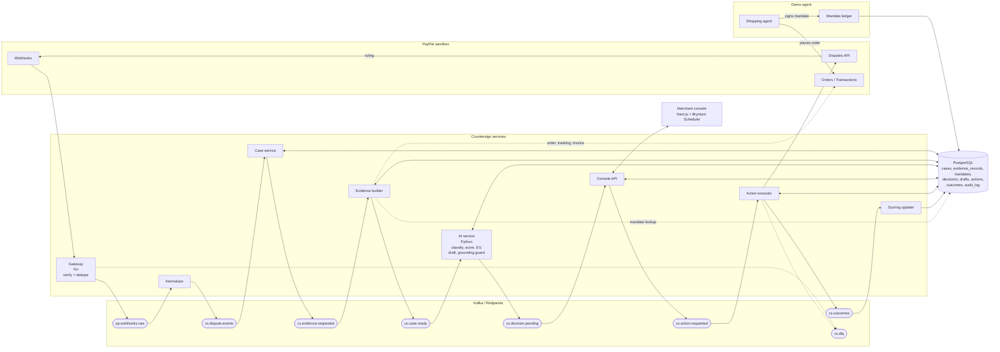
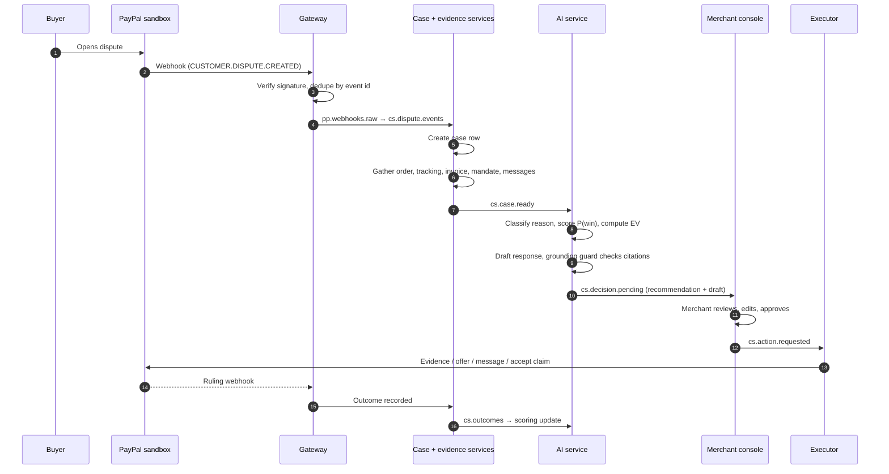

# Countersign: high-level architecture

Diagrams are Mermaid and render on GitHub. Topic and table names come from [PLAN.md](../../PLAN.md).

## System overview

## Dispute lifecycle

## Components

| Component | Responsibility | Tech |
|---|---|---|
| Gateway | Receive PayPal webhooks, verify signature, dedupe, publish raw events | Go |
| Normalizer | Map PayPal events to internal dispute events | Go |
| Case service | Own the `cases` row and its state | Go |
| Evidence builder | Assemble hashed evidence records for each case | Go |
| AI service | Classify the dispute, score `P(win)`, compute EV, draft, run the grounding guard | Python |
| Console API | Serve the UI, receive approvals and edits | Go |
| Action executor | Call the Disputes API idempotently; retry; write outcomes | Go |
| Scoring updater | Apply outcomes to the scoring model | Python |
| Mandate ledger | Store signed, hash-chained mandates for agent orders | Go + Postgres |
| Merchant console | Case review, approve/edit, deadline board | Next.js, Bryntum Scheduler |

Language per service is the plan's stated direction (Go gateway, Python AI service); the rest of the split is a proposal.

## Design notes

- **Kafka between stages** gives replay and a dead-letter topic (`cs.dlq`), and keys by dispute id keep one dispute's events ordered.
- **Idempotency** is enforced at two points: the gateway dedupes webhooks by event id, and the executor uses an idempotency key in `actions` so a retry never double-submits.
- **Merchant approval gates every outbound action.** Nothing reaches the Disputes API without passing through the console.
- **Evidence is hashed and the mandate is hash-chained** (`prev_hash`, `signature`), so the proof shown to PayPal can be checked later.
- **Grounding guard** sits between the drafter and the console: uncited sentences are rejected before the merchant sees the draft.
